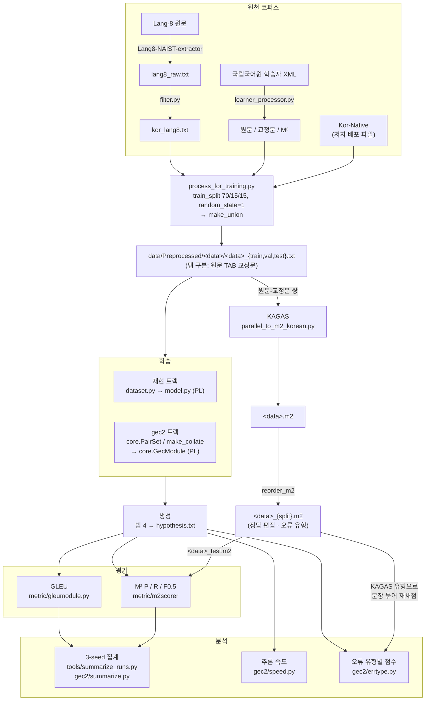

# 코드 해설: 26-13_PHDQ_BART 저장소

2026-10-01 · 기준 커밋 `3b9e05e` (https://github.com/esoterikosQ/26-13_PHDQ_BART, `main`)

이 문서는 GitHub에 올린 코드가 프로젝트 전체에서 어떤 일을 어떻게 하는지 파일·클래스·함수 단위로 설명한다. 구성은 **전처리 → 학습 → 평가 → KAGAS 분석** 순서이고, 각 절 안에서 원 저자 코드와 우리가 새로 쓰거나 고친 코드를 구분한다.

- **[원본]**: 저자 저장소 `soyoung97/Standard_Korean_GEC`(`dfe0af9`)의 코드. 그대로 둔 것
- **[수정]**: 원본을 최신 스택(torch 2.11, PyTorch Lightning 2.6, transformers 4.44)에 맞게 고친 것
- **[신규]**: 이번 재현(KoBART)과 대형 모델 비교(`gec2/`)를 위해 새로 쓴 것

---

## 0. 전체 구조

### 0-1. 두 개의 실험 트랙

| 트랙 | 목적 | 진입점 | 실행 위치 |
| --- | --- | --- | --- |
| **재현 트랙** (legacy recipe) | 논문 Table 6의 KoBART 결과를 `skt/kobart-base-v1`로 재현 | `run.py` + `model.py` + `dataset.py` + `tokenizer_setup.py`, 실행은 `tools/run_one.sh`·`tools/run_all.sh` | itcerdo (RTX 5090) |
| **gec2 트랙** | 같은 데이터·평가로 더 큰 모델 4개(pko-t5-base/large, mBART-50, kanana-1.5-2.1b)와 KoBART를 HF 표준 방식으로 비교 | `gec2/core.py` (`train_seq2seq.py`, `train_llm.py`가 호출), 실행은 `gec2/run_queue.sh`·`gec2/slurm/*.sbatch` | seq2seq는 itcerdo, LLM은 KISTI Neuron |

두 트랙은 데이터 파일과 채점기(GLEU, M² scorer)를 공유한다. 학습 코드는 서로 독립이다. 재현 트랙은 논문 당시 동작을 재현하려고 원본 코드 구조를 유지했고, gec2 트랙은 현재의 HF 표준 방식으로 새로 썼다.

### 0-2. 데이터 흐름



데이터 파일은 저작권 조건(비상업, 신청서로 배포) 때문에 저장소에 없다. itcerdo의 `~/projects/phdq_bart/data/Preprocessed/`와 Neuron의 `/scratch/r984a02/phdq_bart/data/`에만 있다. 정답 M²(`<data>_test.m2`)는 저자가 데이터와 함께 배포한 것을 그대로 썼다. 이번 작업에서 KAGAS를 다시 돌려 M²를 만들지는 않았다.

### 0-3. 디렉토리 지도

| 경로 | 구분 | 역할 |
| --- | --- | --- |
| `get_data/` | 원본 | 코퍼스 정제(Lang-8), 학습자 XML → M², 분할·union 생성 |
| `KAGAS/` | 원본 | 한국어 자동 오류 유형 분류기(정답 M² 생성) |
| `metric/` | 원본 | GLEU(`gleu.py`, `gleumodule.py`), M² scorer(`m2scorer/`) — 두 트랙이 실제로 쓰는 채점기 |
| `eval/` | 원본 | GLEU의 다른 사본(`open()`에 `encoding` 인자가 없는 것 외에는 `metric/`과 같음). 학습 코드에서는 쓰지 않음 |
| `src/KoBART-gec/` | 원본 | 논문 당시 실험 코드(transformers 4.0, PL 1.1). 실행하지 않고 재현 기준으로만 참고 |
| `run.py`, `model.py`, `dataset.py` | 수정 | 재현 트랙 학습·평가 |
| `tokenizer_setup.py` | 신규 | `skt/kobart-base-v1` 토크나이저 로딩·특수 토큰 검사 |
| `tools/` | 신규 | 재현 트랙 실행 스크립트, 점검·진단 스크립트 |
| `gec2/` | 신규 | 대형 모델 비교: 학습·평가·분석, itcerdo 대기열, Neuron SLURM 스크립트 |
| `neuron_outputs/`, `logs/slurm/` | 산출물 | Neuron에서 push한 run 기록(점수·출력·설정, 체크포인트 제외) |
| `docs/` | 문서 | 계획·결과·작업 기록 |
 
---

## 1. 전처리

전처리는 세 단계다. (1) 원천 코퍼스에서 원문–교정문 쌍을 만들고, (2) 학습/검증/테스트로 나눠 union을 만들고, (3) 학습 직전에 모델 입력(토큰 ID)으로 바꾼다. (1)·(2)는 저자 코드이고 이번에는 저자가 배포한 결과 파일을 그대로 썼다. 대신 그 파일이 저자 절차와 같은지를 우리 점검 스크립트로 확인했다. (3)은 트랙마다 다르다.

### 1-1. 원천 코퍼스 → 문장 쌍 [원본]

#### `get_data/filter.py` — Kor-Lang8 정제

Lang8-NAIST-extractor로 뽑은 한국어 학습자 글(`lang8_raw.txt`, 탭 구분)을 걸러 `kor_lang8.txt`를 만든다. 이번 작업에서는 이 단계를 다시 돌리지 않고 배포 파일을 그대로 썼다.

**마지막 자모 거리 필터는 코드와 배포 데이터가 반대다.** 저자 README의 실행 로그(원 README "1. How to get data > Kor-Lang8", 저장소 `docs/ORIGINAL_README.md` 79–97행)로 단계별 쌍 수를 보면 다음과 같다.

| 단계 | 쌍 수 |
| --- | --- |
| 로드 | 406,271 |
| 공백·오작동 사례 제거 | 323,531 |
| 조건 필터 | 203,604 |
| 중복 제거 | 192,183 |
| 자모 거리 필터 직전 | 122,641 |
| 자모 거리 필터 후 | 13,080 |

코드(183행)는 자모 편집거리가 **10을 넘는** 쌍, 즉 원문과 교정문이 많이 다른 쌍만 남기고, 로그의 13,080쌍이 그 결과다. 그런데 필터 직전 122,641쌍에서 13,080쌍을 빼면 **109,561쌍**이다. 이는 논문의 Kor-Lang8 크기(109,559쌍)·배포 데이터(109,560쌍)와 거의 같다. 실제로 배포 데이터 109,560쌍의 자모 편집거리를 같은 함수(`soynlp.hangle.jamo_levenshtein`)로 계산하면, 99.93%(109,479쌍)가 **10 이하**다(평균 3.28, 최대 19). 10을 넘는 81쌍은 따옴표·쉼표 앞뒤 띄어쓰기처럼 필터 뒤 문장부호 정리로 거리가 늘어난 경우다. 따라서 배포 데이터는 **자모 거리 10 이하의 쌍을 남긴 것**이고, 저장소 코드의 부등호는 실제 데이터를 만들 때와 반대로 들어가 있다. 지나치게 많이 고친 쌍(교정이 아니라 다시 쓴 문장)을 걸러 낸다는 필터의 목적에도 이쪽이 맞다. 저장소 코드를 그대로 돌리면 배포 데이터와 다른 13,080쌍짜리 데이터가 나온다.

| 함수 | 하는 일 |
| --- | --- |
| `parse_args()` | 입력·출력 경로 인자 |
| `load_data(path)` | 탭으로 나눠 원문·교정문 리스트를 만든다. 탭이 하나가 아닌 줄은 버린다 |
| `remove_misfunctioned_cases(data)` | 원소가 2개가 아니거나 원문·교정문이 2글자 이하인 쌍을 버린다 |
| `drop_other_lang(data)` | 한글·숫자·영문·일부 기호 외의 문자(힌디어·베트남어 등)가 있는 쌍, 한글이 하나도 없는 쌍을 버린다 |
| `calc_vars(data)` | KoBERT SentencePiece 토큰 수·글자 수를 계산하고 조건으로 거른다: 토큰 수 비 0.25–4, 글자 수 비 0.5–1.25, 최소 토큰 수 > 5, 교정문에 `or`·`good`(교정자 코멘트) 없음, 20글자 넘는 어절 없음(`token_too_long`) |
| `token_too_long(org, cor)` | 공백으로 나눈 어절 중 20글자 초과가 있으면 True |
| `cleanup_corpus(data)` | 구두점 앞뒤에 공백을 넣고 연속 공백을 하나로 줄인다. `/`가 있는 쌍을 빼고 중복을 없앤다 |
| `cleanup_punct_and_brackets(list)` | `^` 제거, 괄호 안 내용·`<…>`·`[…]`·`1 )` 같은 번호 제거, 반복되는 `ㅋ ㅠ ㅜ ~ ? ! .` 등을 하나로 줄인다 |
| `split_sentences(orig, cor)` | 마침표가 여러 개인 글을 마침표로 나눠 문장 단위 쌍으로 만든다(나눈 개수가 같고, 다르며, 5글자 이상인 문장만) |
| `only_leave_unique(data)` | 원문 = 교정문인 쌍을 뺀다 |
| `final_cleanup_and_write(filename, res)` | 탭이 섞인 쌍과 2글자 미만을 빼고, 코드상으로는 **자모 단위 Levenshtein 거리 > 10**인 쌍만 남겨 `kor_lang8.txt`로 쓴다. 배포 데이터는 반대로 거리 ≤ 10인 쌍이다(위 설명) |
| `get_df`, `write` | 이전 버전의 보조 함수. `main()`에서는 쓰지 않는다 |

`main()`의 순서: 로드 → 일본어·한자·영문 제거, 공백 정리 → `remove_misfunctioned_cases` → `drop_other_lang` → `calc_vars` → `cleanup_corpus` → `cleanup_punct_and_brackets` → `split_sentences` → `only_leave_unique` → `final_cleanup_and_write`.

#### `get_data/hangul_util.py` — 한글 음절 조합·분해

`filter.py`가 `import *`로 가져온다(`numpy as np`도 이 경로로 들어온다).

| 함수 | 하는 일 |
| --- | --- |
| `compose(cho, jung, jong)` | 초·중·종성 → 유니코드 음절(`0xAC00 + 588·초 + 28·중 + 종`) |
| `decompose(c)` | 음절 → (초, 중, 종). 한글이 아니면 None |
| `character_is_korean(c)` | 완성형 음절·자음·모음 범위 확인 |

참고로 `jaum_begin`이 `912593`으로 오타가 나 있어(12593이어야 함) 낱자음 범위 판정은 항상 거짓이다. 완성형 음절 처리에는 영향이 없다.

#### `get_data/korean_learner/learner_processor.py` — Kor-Learner(국립국어원 학습자 말뭉치) XML → 원문·교정문·M²

학습자 말뭉치 XML의 `<SENTENCE>`에는 형태소 분석(`MorphemeAnnotations`)과 오류 주석(`LearnerErrorAnnotations`, 형태소마다 `Proofread`·`Preserved`·`Removed`)이 붙어 있다. 이 스크립트는 오류 주석을 적용해 교정문을 조립하고 M² 편집을 쓴다.

| 함수 | 하는 일 |
| --- | --- |
| `gather_xml(xml_dir)` | 말뭉치 폴더 중 `문어` 폴더의 XML을 한 곳으로 모은다 |
| `parse_xml(file)` | 오류 주석이 있는 `<SENTENCE>`만 골라낸다 |
| `make_learner_xml(path)` | 여러 XML의 오류 문장을 하나의 XML(`korean_learner_corpus_error_sentences.xml`)로 합친다 |
| `get_ano_and_cor(morph)` | 형태소 하나의 주석 → (오류 유형, 교정 형태). `Preserved`면 유지, `Removed`면 삭제, `Proofread`면 교정 형태와 품사 첫 글자(`J`·`E` 등) 또는 `UNK`를 돌려준다. `ADD`는 삽입 |
| `sentence_process(sent_dict)` | 어절마다 오류 주석과 맞춰 교정 형태소를 이어 붙인다. `check_jaum_token`(예: `가리키ㄴ다` → `가리킨다`)과 `apply_short_rule`(예: `하였다` → `했다`)로 형태소 결합형을 실제 표기로 바꾸고, 다음 어절이 자음으로 시작하면 `merge_two_token`으로 앞 음절의 받침에 붙인다. 결과로 원문, 교정문, `A i i+1|||유형|||교정|||REQUIRED|||-NONE-|||0` 형식의 M² 편집 목록을 돌려준다 |
| `parse_main_args()`, `main()` | XML 하나를 읽어 원문·교정문·합본(탭 구분)·M² 파일 4개를 쓴다 |

이 스크립트의 M²는 형태소 주석 기반(유형 `J`, `E`, `UNK` 등)이다. 학습·평가에 쓰는 최종 정답 M²는 이것이 아니라 **KAGAS로 다시 만든 것**이다(4절).

#### `get_data/korean_learner/hangle_util.py` — 형태소 결합·축약 규칙

| 함수 | 하는 일 |
| --- | --- |
| `compose`, `decompose`, `character_is_korean`, `is_jaum` | 음절 조합·분해, 자음 여부 |
| `check_jaum_token(tok)`, `merge_jaum_token(i, tok)` | 토큰 안의 낱자음(형태소 `ㄴ`, `ㄹ` 등)을 앞 음절의 받침으로 합친다 |
| `merge_two_token(left, right)` | 오른쪽 토큰이 자음으로 시작하면 왼쪽 마지막 음절의 받침으로 합친다 |
| `apply_short_rule(tok)` | 아래 규칙을 더 바뀌지 않을 때까지 반복 적용한다 |
| `rule_34`, `rule_35`, `rule_36`, `rule_thumb` | 한글 맞춤법 제34–36항 준말 규칙과 경험 규칙. 34항: 같은 모음 탈락·`하였` → `했`(예: `가았` → `갔`). 35항: `ㅗ/ㅜ/ㅚ` + `았/었` → `ㅘ/ㅝ/ㅙ`(예: `보았` → `봤`, `되었` → `됐`, `놓았` → `놨`). 36항: `ㅣ` + `었` → `ㅕ`(예: `가지었` → `가졌`). 경험 규칙: `렵/럽` + `어` → `려워/러워`(예: `어렵어` → `어려워`) |
| `compose_moum(a, b)` | 모음 두 개를 이중모음 하나로 합친다 |
| `levenshtein`, `jamo_levenshtein` | 글자·자모 단위 편집 거리 |

### 1-2. 분할·union·M² 정렬 [원본]

#### `get_data/process_for_training.py`

대화형 메뉴(`main()`)로 아래 동작을 고른다. 데이터 준비에 실제로 쓰는 것은 `train_split`, `make_union`, `reorder_m2`, `split_pairs`다.

| 함수 | 하는 일 |
| --- | --- |
| `train_test_val_split(path)` | 전체 쌍을 `train_test_split(test_size=0.3, random_state=1)`로 70%와 30%로 나누고, 30%를 다시 반씩(`random_state=1`) 검증·테스트로 나눠 `<data>_{train,val,test}.txt`로 쓴다. 이 분할을 그대로 재현할 수 있는지 `tools/check_split_nfkc.py`로 확인했다 |
| `make_union()` | lang8 → korean_learner → native 순서로 split별 `.txt`와 `.m2`를 이어 붙여 `union/union_{split}.txt/.m2`를 만든다. `.txt` 사이에는 빈 줄을 넣지만 `.m2` 사이에는 넣지 않아, `union_test.m2`의 데이터셋 경계 2곳에 블록 구분 빈 줄이 없다(`gec2/errtype.py`가 `S ` 줄 기준으로 나누는 이유) |
| `reorder_m2(m2_path, align_path)` | 전체 데이터에 대해 한 번 만든 M²(`<data>.m2`)를 원문 문장을 키로 삼아 split 파일의 문장 순서대로 다시 배열해 `<data>_{split}.m2`를 만든다. 그래서 `<data>_test.txt`의 i번째 줄과 `<data>_test.m2`의 i번째 블록이 같은 문장이다 |
| `split_pairs(path)` | 탭 구분 파일을 `_original.txt`(원문)와 `_corrected.txt`(교정문)로 나눈다. KAGAS와 self-GLEU의 입력 |
| `punct_split()` | 구두점 앞뒤에 공백을 넣은 `_punct.txt`를 만든다 |
| `merge_files`, `merge_wiki`, `prepare_wiki_cloud`, `make_sample`, `write` | 파일 합치기, 위키 데이터(논문 본 실험에는 쓰이지 않음), 500쌍 샘플 생성 등 보조 기능 |

### 1-3. 전처리 결과 점검 [신규]

저자가 배포한 데이터를 그대로 쓰기 전에, 위 절차와 같은 결과인지 확인한 스크립트다.

#### `tools/check_data.py`

- `raw_lines`, `kept_rows`(학습 코드의 `read_docs`와 같은 필터), `m2_sources`(M²의 `S ` 줄) 세 함수로 각 split 파일을 읽는다.
- 확인 항목: 빈 줄·탭 개수 이상, 필터 후 남는 쌍 수와 논문 Table 1의 문장 수 비교(각 데이터셋 1쌍 차이), `_original/_corrected.txt`와 열 일치, `.m2`의 `S ` 줄과 원문 일치, union이 세 데이터셋의 합집합(멀티셋)인지, split 사이 중복 쌍.

#### `tools/check_split_nfkc.py`

- `train_test_val_split`과 같은 방식(`random_state=1`)으로 다시 나눠 현재 파일과 순서까지 같은지 확인한다.
- 모든 파일에 NFKC 정규화가 적용됐는지(NFKC로 바뀌는 줄 수), Raw와 Preprocessed가 같은지 확인한다.

### 1-4. 문장 쌍 → 모델 입력 (재현 트랙) [수정·신규]

#### `tokenizer_setup.py` [신규]

| 이름 | 하는 일 |
| --- | --- |
| `BASE_MODEL` | `'skt/kobart-base-v1'` |
| `EXPECTED_SPECIAL_TOKENS`, `EXPECTED_CONFIG` | 코드가 하드코딩으로 전제하는 값: `<s>`=0, `</s>`=1, `<pad>`=3, `<unk>`=5, `<mask>`=6, vocab 30000, config의 `decoder_start_token_id`=1 등 |
| `load_tokenizer(name, add_bos_eos)` | `PreTrainedTokenizerFast`를 읽는다. `add_bos_eos=True`(recipe `root`)면 `RobertaProcessing` 후처리를 붙여 `encode()`가 `[0] + ids + [1]`을 돌려주게 한다(원본 루트 코드가 쓰던 `hyunwoongko/kobart`와 같은 형식). `False`(recipe `legacy`, 논문 실험)면 특수 토큰을 붙이지 않는다 |
| `check_tokenizer(tok, add_bos_eos)` | 특수 토큰 ID·문자열, vocab 크기, `encode` 결과 형식을 확인하고 다르면 예외를 던진다 |
| `check_model_config(config)` | 모델 config의 특수 토큰 값이 기대값과 같은지 확인한다 |
| `special_token_report(tok, config, args)` | 실행마다 `outputs/<data>/<run_id>/special_tokens.json`에 남기는 요약(생성 설정, 특수 토큰, 후처리기 종류, 예시 인코딩, config) |

#### `dataset.py` [원본, 주석만 추가]

| 클래스·메서드 | 하는 일 |
| --- | --- |
| `KoBARTGecDataset.read_docs(filename)` | 줄을 탭으로 나눠 **열이 정확히 2개이고 둘 다 비어 있지 않은 줄만** 남긴다. 이 규칙은 gec2의 `read_pairs`와 점검 스크립트들이 똑같이 따른다 |
| `add_padding_data(inputs)` | `max_len`(128)까지 `pad_index=0`으로 채우거나 자른다. 패딩 값이 실제 `<pad>`(3)가 아니라 **0(`<s>`와 같은 ID)** 이다. 원본 그대로이며, 모델의 attention mask도 `ne(0)`으로 만든다 |
| `add_ignored_data(inputs)` | 라벨을 `-100`(손실 무시)으로 채우거나 자른다 |
| `__getitem__(idx)` | `input_ids = encode(원문)` + 0 패딩. `labels = encode(교정문) + [</s>=1]`, -100 패딩. `decoder_input_ids = [0] + labels[:-1]`, 0 패딩(teacher forcing용으로 한 칸 민 정답). legacy recipe에서는 `encode`가 특수 토큰을 붙이지 않으므로 인코더 입력에 `<s>`·`</s>`가 없다(논문 당시 SKT 토크나이저와 같음) |
| `GecDataModule` | train(셔플)·val·test `DataLoader`를 만든다. `train_noshuffle_dataloader`는 쓰지 않는다 |

#### `tools/check_special_tokens.py` [신규] — 매 run 전에 실행하는 관문

`tools/run_one.sh`가 학습 전에 실행하고, 하나라도 실패하면 run을 중단한다. 인자 `root|legacy`에 따라 비교 기준이 바뀐다(`legacy`면 SKT 레거시 토크나이저 파일 `~/.cache/kobart_legacy`).

1. 토크나이저 구성(normalizer·pre_tokenizer·decoder·vocab·merges·special tokens)이 기준과 같은지
2. 모델 config·generation_config 차이 출력, 임베딩 행 수 = vocab = `len(tokenizer)`
3. union 전체(train/val/test)를 두 토크나이저로 인코딩해 **전수 일치**하는지, `KoBARTGecDataset` 출력(input/decoder_input/labels)이 전수 일치하는지, 128토큰 초과 비율, `<unk>` 비율, decode 일치
4. 하드코딩과의 정합성: legacy면 라벨 끝이 `</s>` 1개, `decoder_input_ids = [0] + labels[:-1]`
5. **디코더 누설 검사**: 디코더 입력의 세 번째 위치 이후를 무작위 토큰으로 바꿔도 첫 위치의 logits가 변하지 않아야 한다(`model.make_decoder_attention_mask` 적용 상태)

#### `tools/check_tokenizer.py` [신규]

초기 점검용(plan.md §3-2, §3-3). `skt/kobart-base-v1`의 특수 토큰·config를 출력하고, 원본 토크나이저와 vocab·인코딩을 비교하며, 모델을 GPU에 올려 `generate` 스모크 테스트를 한다.

### 1-5. 문장 쌍 → 모델 입력 (gec2 트랙) [신규]

gec2는 모델마다 토크나이저가 달라서, **모델 형식은 토크나이저 기본 동작을 따르고, 평가는 원문 텍스트 기준으로 한다**는 원칙으로 짰다.

#### `gec2/core.py`의 데이터 부분

| 이름 | 하는 일 |
| --- | --- |
| `PROMPT` (L24) | LLM 입력 형식: `다음 문장의 문법 오류를 고치세요.\n입력: {src}\n출력: ` |
| `Formatter` (L62) | 모델별 입출력 형식과 생성 인자를 한곳에 모은다 |
| `Formatter.__init__` | seq2seq: mBART면 `src_lang=tgt_lang='ko_KR'`, 생성 시 `forced_bos_token_id=ko_KR`. 토크나이저가 끝에 eos를 붙이지 않으면(KoBART) `wrap=True`로 `<s> … </s>`를 직접 감싼다. T5는 `… </s>`, mBART-50은 `[ko_KR] … </s>`로 토크나이저가 알아서 붙인다. LLM: pad가 없으면 pad=eos로 두고, 생성 인자에 eos·pad를 넣는다 |
| `enc_src(texts)` | seq2seq: 원문 인코딩(필요하면 감싸기). LLM: `PROMPT.format(src=원문)` 인코딩(토크나이저 기본 BOS 포함) |
| `enc_tgt(texts)` | seq2seq: `text_target=`으로 정답 인코딩. LLM: 특수 토큰 없이 정답 인코딩 + eos |
| `decode(seqs, prompt_len)` | 생성 결과 → 문자열. LLM은 프롬프트 뒤만 잘라 **첫 줄만** 쓰고, 줄바꿈으로 잘린 수(`newline_cut`)와 빈 출력 수(`empty`)를 센다 |
| `PairSet` (L114) | 문장 쌍을 한꺼번에 인코딩해 `(원래 순서 idx, src_ids, tgt_ids)`로 보관한다. `sort_by_len=True`(검증·테스트)면 긴 문장부터 정렬해 생성 batch의 패딩 낭비를 줄이고, 결과는 `idx`로 원래 순서로 되돌린다. `max_src`, `max_tgt`를 기록한다 |
| `make_collate(fmt, gen)` (L130) | batch를 텐서로 만든다. seq2seq: `input_ids`(오른쪽 pad), `attention_mask`, `labels`(-100 pad). 디코더 입력은 만들지 않고 모델 내부의 `shift_tokens_right`에 맡긴다(HF 표준). LLM: `프롬프트+정답`을 이어 붙인 `input_ids`, 라벨은 프롬프트 구간을 -100으로 가려 **정답과 eos에만 손실**. `gen=True`면 생성용으로 프롬프트만 **왼쪽 패딩**한 `gen_input_ids`·`gen_attention_mask`를 추가한다 |

#### `gec2/evaluate.py`의 읽기 함수

| 함수 | 하는 일 |
| --- | --- |
| `read_pairs(path)` | `KoBARTGecDataset.read_docs`와 같은 필터로 `(원문, 교정문)` 목록을 읽는다 |
| `split_path(root, data, split)` | `<root>/<data>/<data>_<split>.txt` |
| `read_hyp(path)` | 마지막 줄바꿈 유무와 관계없이 출력 파일을 줄 단위로 읽는다 |

#### `gec2/precheck.py` — 모델별 사전 점검 (plan2 §4)

| 함수 | 하는 일 |
| --- | --- |
| `classify(x, d)` | 원문 x와 인코딩→디코딩 결과 d를 비교해 `same`, `whitespace`(공백만 다름), `nfkc`(NFKC로 같아짐), `other`로 분류 |
| `main()` | 네 데이터셋 전체의 고유 문장(약 27.9만 개)에 대해 **원문 복원율**과 `<unk>` 비율, 데이터셋·split별 토큰 길이(p99.9, 최대, 정답/원문 비, LLM은 합계 길이), 예시 인코딩을 `outputs2/precheck/<tag>.json`에 쓴다. `--leak`이면 모델을 올려 `leak_check`(2-2절)와 학습 전 생성 형식까지 확인한다 |

---

## 2. 학습

### 2-1. 재현 트랙 [수정·신규]

#### `run.py` — 진입점

| 이름 | 하는 일 |
| --- | --- |
| `parse_common_args()` | 인자 정의. 주요 인자: `--data`, `--run_id`(데이터셋·시나리오·seed마다 고유, 출력 경로를 가름), `--lr`, `--batch_size`, `--max_epochs`, `--max_seq_len`, `--seed`, `--model_ckpt_path`, `--resume_finetune`(시나리오 2의 2단계), `--eval_test`(테스트만), `--recipe`, `--attn_implementation`(eager/sdpa, native 정밀도 조사용) |
| `RECIPES` | 설정 묶음 두 가지. **`legacy`(논문 재현에 사용)**: 토크나이저 후처리 없음, cosine 스케줄 + warmup 0.1, gradient clipping 1.0, 생성 시작 토큰 0, forced eos 없음, repetition_penalty 1.0. `root`: 원본 루트 코드 조건(`<s>…</s>`, linear, warmup 0, clip 없음, 시작 토큰 1, forced eos 1, rep 2.0). `root`는 최신 transformers에서 디코더 누설을 피할 수 없어 점검에서 실패하므로 비교용으로만 남겼다 |
| `apply_recipe(args)` | `None`으로 남은 인자를 recipe 값으로 채운다. `forced_eos_token_id=-1`은 None(끔)으로 바꾼다 |
| `current_time()`, `write_command_logs()` | KST 시각과 실행 명령을 `logs/command_logs.txt`에 덧붙인다 |
| `cli_main()` | 인자 처리, 데이터 경로 기본값(`<data_root>/<data>/<data>_<split>.txt`)과 존재 확인, `num_workers`=CPU 수/2, `pl.seed_everything(seed)` 후 `run_mode` 호출 |
| `get_device_count()` | 사용 가능한 GPU 수(지금은 쓰지 않음) |
| `run_mode(args)` | ① `skt/kobart-base-v1` config 검사 후 모델 로드(`attn_implementation` 반영, 실제 attention 클래스 출력) ② 토크나이저 로드, 특수 토큰 보고서 기록 ③ `GecDataModule`, `KoBARTConditionalGeneration` 생성 ④ `ModelCheckpoint(monitor='val_gleu', mode='max', save_top_k=1)`로 **검증 GLEU 최고 체크포인트 1개만** `outputs/<data>/<run_id>/model_ckpt/`에 저장 ⑤ PL 2.x `Trainer`(GPU 1장, gradient clip, CSVLogger) ⑥ 모드 분기: 처음 학습은 `fit`, `--resume_finetune`은 가중치만 불러와 `fit`(옵티마이저·스케줄러는 새로 시작), `--eval_test`는 가중치를 불러와 `test`(생성 경로의 epoch 번호는 체크포인트 epoch), 그 외에는 `validate` |

원본에서 바꾼 점: PL 2.x에서 없어진 `Trainer.from_argparse_args`·`strategy='dp'` 제거, `--data` 기반 경로, run별 출력 분리, 시나리오 2·테스트 전용 모드, 실행마다 특수 토큰 기록.

#### `model.py` — LightningModule

| 이름 | 하는 일 |
| --- | --- |
| `make_decoder_attention_mask(decoder_input_ids, pad_token_id=0)` | **재현의 핵심 수정 1.** 디코더 입력의 첫 토큰이 0(패딩 값과 같음)이라 `ne(0)` 마스크에서 첫 위치가 가려진다. transformers 4.0은 첫 위치를 마스킹하지 않았지만 4.8 이후에는 첫 행이 전부 가려지고, 라이브러리가 그 행을 '전부 보기'로 풀어 버려 **첫 토큰 예측에 정답 뒷부분이 샌다**(plan.md §3-6). 첫 열을 둘째 열 값으로 덮어 4.0과 같게 만든다 |
| `KoBARTConditionalGeneration.assign_attributes` | 모델·토크나이저·데이터모듈과 생성 결과를 모을 리스트(`outputs`, `decoded_labels`, `origs`), epoch 카운터 등 초기화 |
| `configure_optimizers()` | AdamW(`correct_bias=False`, transformers 구현, bias·LayerNorm 제외 weight decay 0.01). 총 step = `학습 쌍 수 × max_epochs / batch_size`, warmup = 총 step × `warmup_ratio`. recipe에 따라 cosine 또는 linear 스케줄을 step마다 갱신 |
| `forward(inputs)` | 인코더 mask(`input_ids != 0`), 디코더 mask(`make_decoder_attention_mask`)와 `decoder_input_ids`, `labels`를 넣어 손실을 계산한다 |
| `on_train_epoch_start()` | **재현의 핵심 수정 2.** `from_pretrained()`는 eval 모드로 돌려주고 PL 2.x는 학습 시작 때 `train()`을 부르지 않는다. 그대로 두면 dropout 없이 학습된다. 또 검증 중 `generate()`가 `model.eval()`을 호출하므로 다음 epoch도 eval로 남는다. 매 epoch 시작에 `self.train()`으로 되돌린다(plan.md §3-7) |
| `training_step()` | 첫 batch에서 내부 BART가 eval 모드면 예외(안전장치), 손실 기록 |
| `on_train_epoch_end()` | epoch별 생성 시간 기록, epoch 카운터 증가(PL 2.x 훅 이름으로 변경) |
| `generate(input_ids, labels)` | 빔 4, `max_length=128`, eos 1, recipe의 시작 토큰·forced eos·repetition_penalty로 생성한다. 출력·정답·원문을 **토크나이저로 디코딩해서** 모은다(이 디코딩 텍스트 기준 GLEU가 학습 중 모델 선택에 쓰였다. 원문 텍스트 기준 재채점과의 차이는 3-3절 `rescore_kobart.py`) |
| `validation_step()`, `test_step()` | 손실 계산 + 생성 |
| `on_validation_epoch_end()`, `on_test_epoch_end()` → `eval_epoch_end(mode)` | 평균 손실, `outputs/generation/<data>/<run_id>/epoch<N>/<mode>/`에 `hypothesis/reference/source.txt`를 쓰고 `run_gleu`로 GLEU를 계산해 `gleu.txt`에 인자와 함께 기록한다. `val_gleu`를 log해 체크포인트 선택에 쓴다. 원본에 있던 고장 난 KAGAS·M² 호출(f-string 누락, 정의되지 않은 명령, 0점 대체)은 지웠고, M²는 테스트 후 따로 계산한다 |

**재현의 핵심 수정 3**(토큰화 형식)은 `tokenizer_setup.load_tokenizer(add_bos_eos=False)`와 recipe `legacy`의 생성 시작 토큰 0이다. 이 세 가지(형식, 디코더 첫 위치 마스킹, dropout)가 맞춰진 뒤 7개 조합이 논문 수치에 도달했다.

#### 실행 스크립트

| 파일 | 하는 일 |
| --- | --- |
| `tools/run_one.sh <data> <run_id> <seed> <lr> <recipe> [init_ckpt]` | run 하나의 전 과정: ① `check_special_tokens.py` ② `run.py`로 학습(batch 64, 10 epoch, max_seq_len 128, `init_ckpt`가 있으면 `--resume_finetune`) ③ 최고 체크포인트로 `--eval_test` ④ `m2scorer.py`로 M² 채점. 단계마다 `logs/runs.log`에 START/TRAIN DONE/TEST DONE/M2 DONE 줄을 남긴다 |
| `tools/run_all.sh <tag>` | 21 run 대기열. 시나리오 1(korean_learner, native, union; lr 3e-5, seed 0–2) → 시나리오 2(같은 seed의 union 체크포인트에서 korean_learner·native를 lr 1e-5로 추가 학습, run_id `afterunion_<tag>_seedN`) → 가장 오래 걸리는 lang8의 시나리오 1·2. union 학습이 시나리오 2의 1단계를 겸한다. 완료 run은 `.done` 파일로 건너뛰고, 실패해도 기록 후 다음으로 넘어간다 |

#### 진단 스크립트 (재현 과정에서 원인을 찾을 때 쓴 것)

| 파일 | 하는 일 |
| --- | --- |
| `tools/check_train_mode.py` | 작은 Lightning 모듈로 PL 2.x에서 `training_step` 중 내부 BART가 train 모드인지 확인한다(dropout이 꺼져 있던 문제를 찾은 스크립트) |
| `tools/cmp_new.py` | 현재 환경(transformers 4.44): 체크포인트 가중치·입력을 torch 1.7이 읽을 수 있게 저장하고, 생성 256문장·forward logits를 저장 |
| `tools/cmp_old.py` | transformers 4.0.0 + torch 1.7 환경(`.venv-tf400`): 레거시 코드와 같은 config·호출로 같은 입력을 생성·forward |
| `tools/cmp_report.py` | 두 결과의 생성 토큰 일치 수, 첫 토큰, logits 최대 차이, 손실을 비교(생성 시작 토큰 0 확인 등) |
| `tools/inspect_author_ckpt.py` | 저자 체크포인트(PL 1.1 pickle)를 클래스 없이 열어(`Dummy` 언피클러) epoch·global step·스케줄러·옵티마이저 상태를 보고, 우리 계산의 cosine lr과 대조 |

### 2-2. gec2 트랙 [신규]

#### `gec2/core.py` — 공통 학습·평가 코드

`train_seq2seq.py`는 `main('seq2seq')`, `train_llm.py`는 `main('llm')`만 호출한다. 모든 동작이 이 파일에 있다.

**보조 함수**

| 함수 | 하는 일 |
| --- | --- |
| `now()`, `log(msg)` | KST 시각, rank 0에서만 출력 |
| `global_rank()`, `rank_zero()` (L32) | Trainer 생성 전에도 쓸 수 있는 rank 판정(`RANK`, `LOCAL_RANK`, `SLURM_PROCID`) |
| `dump_json`, `append_jsonl` | 기록 파일 쓰기 |
| `sh(cmd)`, `run_info(args)` (L247) | 실행 환경 기록: 시각, 호스트, 명령, 인자, git 커밋·변경 여부, SLURM 변수, `nvidia-smi`, 라이브러리 버전, `pip freeze` → `run_info.json` |

**모델 로드·검사**

| 함수 | 하는 일 |
| --- | --- |
| `load_model(args, kind)` (L164) | `AutoModelForSeq2SeqLM` 또는 `AutoModelForCausalLM`과 `AutoTokenizer`를 읽는다. seq2seq는 dropout을 0.1로 통일한다(T5는 `dropout_rate`, 그 외 `dropout`). LLM은 config 기본값 |
| `dropout_report(model)` | config의 dropout 관련 값과 `nn.Dropout` 모듈의 p별 개수 |
| `alt_token(tok, cur)` | 누설 검사용으로 현재 토큰과 다른 일반 토큰 ID |
| `leak_check(model, fmt, batch, device)` (L199) | 정답 토큰 k를 다른 토큰으로 바꿨을 때, k를 예측하는 위치까지의 logits는 **변하지 않고**(미래 정보 누설 없음) 그다음 위치는 **변해야**(입력으로 실제 쓰임) 통과다. 정답의 첫 위치와 가운데 위치 두 곳을 검사한다. seq2seq는 디코더 시작 토큰이 config 값과 같은지, LLM은 손실이 프롬프트 바로 뒤에서 시작하는지도 확인한다. 학습 전에 실행하고 실패하면 중단한다 |

**체크포인트 선택·조기 종료**

`es_update(st, gleu, ep, args)` (L266): 두 기준을 따로 관리한다.
- **최고 체크포인트**: 검증 GLEU가 조금이라도 오르면 갱신(`best_gleu`, `best_epoch`). 테스트에 쓰는 모델
- **조기 종료 기준값**: `min_delta`(0.2) 이상 오를 때만 갱신. 갱신되지 않은 epoch가 `patience`(3)회 연속이면 중단하되 `min_epochs`(4) 이후부터만

seq2seq는 기본적으로 조기 종료 없이 10 epoch을 고정으로 돌리고, LLM은 조기 종료를 켠다.

**`GecModule` (L284) — LightningModule**

| 메서드 | 하는 일 |
| --- | --- |
| `__init__`, `_reset_eval` | 상태(`st`: 최고 GLEU·epoch, 조기 종료 상태, 중단 이유)와 평가 축적 버퍼 초기화 |
| `on_save_checkpoint`, `on_load_checkpoint` | 재개용 체크포인트(`last.ckpt`)에 `st`를 함께 저장·복원 → 작업을 나눠 제출해도 최고 기록과 조기 종료 카운트가 이어진다 |
| `configure_optimizers()` (L304) | `torch.optim.AdamW`(bias 보정 포함, betas 0.9/0.999, eps 1e-8). bias와 이름에 `norm`이 들어간 모듈(LayerNorm, T5LayerNorm, RMSNorm 등)의 파라미터는 weight decay 0. 총 step은 `trainer.estimated_stepping_batches`(예정된 10 epoch 기준으로 고정, 조기 종료·재개와 무관), warmup 0.1 + cosine → 0 |
| `on_train_epoch_start()` | `self.model.train()`(재현 트랙에서 찾은 dropout 문제를 처음부터 막음), 메모리 최대치 초기화 |
| `on_train_batch_start()` | 첫 학습 batch에서 모델이 train 모드이고 p>0인 dropout이 모두 활성인지 확인해 `check_train_mode.json`에 쓰고, 아니면 중단 |
| `training_step()` | `model(input_ids, attention_mask, labels)`의 손실. 디코더 입력은 모델이 라벨에서 만든다 |
| `on_train_batch_end()` | gradient accumulation 경계마다 `log_every` step 간격으로 step·loss·lr·경과 시간을 `train_steps.jsonl`에 쓴다 |
| `_generate(batch)` (L364) | 빔 4, 샘플링 없음, `early_stopping=True`, **최대 생성 길이 = min(512, ceil(2 × batch 내 최장 입력 토큰) + 10)**. seq2seq는 디코더 시작 토큰을 떼고, LLM은 프롬프트 길이만큼 잘라 `Formatter.decode`로 문자열을 만든다. 생성 시간을 잰다(`cuda.synchronize`) |
| `_eval_step()`, `validation_step()`, `test_step()` | 토큰 가중 평균용 손실(손실×토큰 수) 축적 + 생성 |
| `_gather()` (L405) | DDP일 때 모든 rank의 `(idx, 출력)`·손실·통계를 `all_gather_object`로 모아 원래 순서로 정렬한다(DistributedSampler가 채운 중복은 `dict`로 제거). 생성 시간은 rank 중 최대, 메모리는 rank별 |
| `on_validation_epoch_end()` (L422) | rank 0에서 `evaluate()`로 검증 GLEU를 계산하고 모든 rank에 broadcast → `es_update` → 최고면 `_save_best` → 중단 판단(조기 종료, `max_epochs`, `--epochs_per_job` 작업 분할) → `epochs.jsonl`에 epoch 기록(손실, GLEU, 최고·기준값, 시간, 메모리, 파싱 통계, lr) |
| `_save_best()` | `ckpt/best.tmp`에 `save_pretrained`(safetensors)와 토크나이저, `best_info.json`을 쓴 뒤 `ckpt/best`로 이름을 바꾼다(저장 중 중단돼도 기존 best가 깨지지 않음) |
| `on_test_epoch_end()` | 테스트 출력을 모아 `evaluate(..., m2=True)`로 GLEU·M²를 계산하고, 생성 속도(문장/초), 최고 epoch·검증 GLEU를 `test/scores.json`에 함께 남긴다 |

**`build_parser(kind)` (L488) / `main(kind)` (L537)**

주요 인자와 기본값: 전역 batch 64(`global_batch`), GPU당 `micro_batch`, `gen_batch_size` 64, 10 epoch, warmup 0.1, weight decay 0.01, clip 1.0, `bf16-mixed`, 빔 4, `--init_weights`(시나리오 2: union의 `ckpt/best`에서 가중치만), `--resume`(`ckpt/last.ckpt`에서 재개), `--test_only`, `--epochs_per_job`, `--gradient_checkpointing`, 스모크용 `--limit_*`.

`main()`의 순서:
1. run 디렉토리 `<out_root>/<model_tag>/<data>/<run_id>`. gradient accumulation = `global_batch / (micro_batch × GPU 수)`(나눠떨어져야 함). 그래서 GPU 구성이 달라도 전역 batch는 항상 64다
2. `seed_everything(seed, workers=True)`, TF32 matmul 허용
3. 모델 로드, `--init_weights`면 state_dict 덮어쓰기, gradient checkpointing 설정, `Formatter` 생성
4. val/test는 길이순 `PairSet`, train은 원래 순서 `PairSet`(셔플은 DataLoader가 한다)
5. rank 0: `run_info.json`, `model_info.json`(파라미터 수, 임베딩 제외 수, 임베딩 공유 여부, dropout, 형식, 특수 토큰, 최대 길이)
6. rank 0: 검증셋에서 가장 짧은 두 문장으로 `leak_check` → `check_leak.json`, 실패 시 중단
7. `ModelCheckpoint(save_last=True, save_top_k=0)`: 매 학습 epoch 끝에 재개용 `last.ckpt`만 저장(평가용 best는 `_save_best`가 따로 관리)
8. `Trainer`: GPU가 여럿이면 `DDPStrategy`, accumulation·clip·precision 적용, 로거·진행바 없음
9. `train_config.json`(실제 적용 설정 전체) 기록 → `fit` → `train_config_applied.json`(총 step·warmup·decay 파라미터 수), `train_state.json`(최종 `st`)
10. `stop_reason`이 비어 있으면(작업 분할로 멈춤) 테스트 없이 종료한다. 다음 작업이 `--resume`으로 이어 받는다
11. `ckpt/best`를 다시 읽어 새 `GecModule`로 테스트한다. 토크나이저는 원본 모델의 것을 쓴다

#### `gec2/memprobe.py`

union 학습셋의 **가장 긴 문장들**로 batch를 만들어 학습 2 step(두 번째 step은 옵티마이저 상태가 있는 실제 최대치)과 빔 생성 1회의 최대 GPU 메모리를 잰다. `micro_batch`·`gen_batch_size`와 gradient checkpointing 여부를 정하는 데 썼다.

#### itcerdo 실행: `gec2/run_queue.sh`, `gec2/queues/*.txt`

- `run_queue.sh <목록 파일>`: 목록 한 줄(`모델 태그 데이터 run_id seed lr micro gen [추가 인자]`)마다 `python3 -m gec2.train_seq2seq`를 순서대로 실행한다. `test/scores.json`이 있으면 건너뛰고, 실패해도 기록하고 다음으로 넘어간다. 결과를 `logs/gec2_runs.log`에 남기고, 완료된 run의 재개용 `last.ckpt`는 지운다.
- `queues/lr_sweep.txt`: 단계 3, korean_learner seed 0으로 모델마다 lr 3개를 탐색했다. 고른 값은 KoBART 5e-5, pko-t5-base 5e-4, mBART-50 3e-5, pko-t5-large 1e-4이고, kanana는 Neuron에서 1e-5를 골랐다.
- `queues/stage4_seed0.txt`: 단계 4, 시나리오 1 seed 0, native → lang8 → union.
- `queues/stage5.txt`: 단계 5, seed 1·2와 시나리오 2(run_id `s2_lr<union lr>_seedN`, lr은 union lr의 1/3).

#### Neuron 실행: `gec2/slurm/`

| 파일 | 하는 일 |
| --- | --- |
| `paths.sh` | 경로(`BASE=/scratch/r984a02/phdq_bart`, 데이터, `OUT_ROOT=<repo>/neuron_outputs`, 모델 디렉토리, conda 환경), 오프라인 모드(`HF_HUB_OFFLINE=1`). 함수: `activate_env`(비대화형 bash에서 conda.sh를 찾아 활성화하고 필수 패키지 확인), `require_job`(SLURM 작업 밖, 즉 로그인 노드에서의 실행을 막음), `limit_threads`(할당 CPU 수로 스레드 제한). 값은 `paths.local.sh`(git 제외)로 덮어쓴다 |
| `common.sh` | sbatch 공통: 제출 위치 확인, 환경 활성화, 데이터·모델 존재 확인, GPU 수 = task 수 확인(Lightning이 srun task마다 GPU 1개), `srun --cpus-per-task` 명시, `save_job_files`(작업 스크립트·`nvidia-smi`를 run 디렉토리에 저장) |
| `precheck.sbatch` / `precheck.sh` | CPU 파티션에서 `gec2.precheck` 실행 |
| `a100x2_smoke.sbatch`, `h200x1_smoke.sbatch` → `llm_smoke.sh` | ① 사전 점검 ② `memprobe`로 micro/생성 batch 5가지 조합의 메모리 측정 ③ native 512쌍으로 1 epoch 학습·검증·테스트 |
| `a100x2_train.sbatch`, `h200x1_train.sbatch` → `llm_train.sh <data> <lr> <seed>` | kanana 학습. 기본 micro 16, gradient checkpointing 없음, 생성 batch 64(스모크 실측 근거는 주석). `S2=<union lr>`이면 시나리오 2(union best에서 시작), `RESUME=1`이면 재개. 80GB 미만 GPU면 바로 중단한다. 테스트까지 끝나면 재개용 체크포인트(약 25GB)를 지운다. sbatch 파일 주석에 데이터셋별 `--time` 산정 근거(실측 epoch 시간 × 10 + 준비·테스트) × 1.2가 있다 |
| `share_results.sh` | 로그인 노드에서 `logs/slurm`과 `neuron_outputs`를 커밋·push한다. 체크포인트와 데이터 원문 사본은 `.gitignore`가 거른다 |

`gec2/NEURON.md`에 Neuron 실행 절차가 정리돼 있다.

### 2-3. 원 저자 학습 코드 `src/KoBART-gec/` [원본, 실행하지 않음]

논문 당시 코드다(transformers 4.0, PL 1.1, SKT `kobart` 패키지). 재현 트랙의 `--recipe legacy`는 이 코드의 동작을 기준으로 정했다.

| 파일·이름 | 내용 |
| --- | --- |
| `train.py` `KobartGecModule` | 데이터모듈 |
| `train.py` `Base.configure_optimizers` | AdamW(`correct_bias=False`) + cosine warmup. 총 step을 `GPU 수`로 나눈다(`dp` 전략) |
| `train.py` `KoBARTConditionalGeneration` | `get_pytorch_kobart_model()`·`get_kobart_tokenizer()`로 로드, `config.dropout` 설정, `forward`의 디코더 마스크는 `ne(0)`을 그대로 쓴다(transformers 4.0에서는 첫 위치가 마스킹되지 않았음), `generate`는 `eos_token_id=1, max_length, num_beams=4`만 준다(레거시 config에서 시작 토큰 0) |
| `train.py` `configure_fixed_args` | 데이터셋별 고정 인자 |
| `dataset.py` | 루트 `dataset.py`와 같은 구조 |
| `augment.py` `AugmentModule` | 마스킹·순서 바꾸기 등 노이즈 증강(본 실험에서는 쓰이지 않음) |
| `infer.py`, `rouge_metric.py`, `get_model_binary.py`, `*.sh`, `Makefile` | 추론, ROUGE, 체크포인트 변환, 실행 스크립트 |

---

## 3. 평가

### 3-1. 채점기 [원본]

#### GLEU — `metric/gleu.py`, `metric/gleumodule.py`

GEC용 n-gram 지표다. 정답(reference)과 겹치는 n-gram은 보상하고, **원문(source)에는 있지만 정답에는 없는 n-gram**(고쳐야 했는데 그대로 둔 부분)을 출력이 가지고 있으면 감점한다. 토큰은 공백 기준이다.

| 이름 | 하는 일 |
| --- | --- |
| `GLEU.load_sources(path)`, `load_references(paths)` | 원문·정답의 문장별 1–4-gram 개수 |
| `GLEU.load_hypothesis_sentence(h)` | 출력 문장의 n-gram |
| `GLEU.get_ngram_diff(a, b)` | a에만 있는 n-gram(원문 − 정답) |
| `GLEU.gleu_stats(i)` | 문장 i의 통계: 출력 길이, 정답 길이, n=1..4마다 `max(|출력∩정답| − |출력∩(원문−정답)|, 0)`과 `출력 길이 − n + 1` |
| `GLEU.gleu(stats)` | 말뭉치 전체 통계로 `exp(min(0, 1 − r/c) + 평균 log 정밀도)`(BLEU식 간결성 벌점 포함) |
| `gleumodule.run_gleu(reference, source, hypothesis)` | 파일 세 개를 받아 말뭉치 GLEU 문자열(0–1)을 돌려준다. 정답 1개, 반복 1회. 두 트랙 모두 이 함수를 쓴다 |
| `gleumodule.get_gleu_stats(scores)` | 평균·표준편차·95% 구간 문자열 |

`eval/`은 같은 코드의 다른 사본(`run_gleu.py` CLI, self-GLEU를 재는 `self_gleu.sh`)이다. 학습 코드는 `metric/`을 쓴다.

#### M² scorer — `metric/m2scorer/scripts/`

출력과 원문 사이의 편집을 정답 M²의 편집 집합과 맞춰 정밀도(P), 재현율(R), F0.5를 계산한다(Dahlmeier & Ng 2012, python3 호환판).

| 파일·함수 | 하는 일 |
| --- | --- |
| `m2scorer.py` (스크립트) | `load_annotation(gold)`로 원문 문장과 정답 편집(주석자별)을 읽고, 출력 파일을 줄 단위로 읽어 `levenshtein.batch_multi_pre_rec_f1`을 부른다. 기본 `max_unchanged_words=2`, `beta=0.5`. `Precision/Recall/F_0.5` 세 줄을 출력한다 |
| `levenshtein.batch_multi_pre_rec_f1` | 문장마다 원문→출력의 Levenshtein 격자에서 편집 그래프를 만들고(`levenshtein_matrix`, `edit_graph`), 바뀌지 않은 단어 2개까지 끼운 인접 편집을 이어 붙인 뒤(`transitive_arcs`, `merge_edits`), 정답 편집과 겹치도록 가중치를 준 최단 경로(`set_weights`, `best_edit_seq_bf`)로 **정답과 최대한 많이 맞는 출력 편집 분해**를 고른다. 맞은 편집 수(`matchSeq`)를 말뭉치 전체로 모아 P·R·F를 계산한다(`comp_p`, `comp_r`, `comp_f1`). 주석자가 여럿이면 문장마다 F가 가장 높은 주석자를 고른다 |
| `util.py`, `Tokenizer.py`, `combiner.py`, `edit_creator.py`, `nuclesgmlparser.py`, `token_offsets.py` | 보조 기능(파일 열기, 토큰화, 주석 합치기, NUCLE SGML 파싱 등). 채점 경로에서는 `util.smart_open` 정도만 쓴다 |

정답 M²에 편집이 없는 문장은 `A -1 -1|||noop|||…` 한 줄이다. 출력이 원문과 같으면 편집 0개로 정밀도에 영향이 없고, 바꾸면 틀린 편집으로 정밀도가 내려간다.

### 3-2. 재현 트랙 평가 [수정·신규]

1. **학습 중 검증**: `model.eval_epoch_end('val')`이 epoch마다 검증셋 전체를 빔 4로 생성하고 GLEU를 계산한다. 이 값(`val_gleu`)으로 최고 체크포인트를 고른다.
2. **테스트**: `run.py --eval_test`가 최고 체크포인트로 테스트셋을 생성하고 GLEU를 쓴다(`outputs/generation/<data>/<run_id>/epoch<N>/test/`).
3. **M²**: `run_one.sh`가 `m2scorer.py hypothesis.txt <data>_test.m2`를 실행해 `m2score.txt`에 쓴다.
4. **집계**: `tools/summarize_runs.py logs/runs.log <tag>`가 로그의 TEST DONE·M2 DONE 줄을 정규식으로 읽어 시나리오·데이터셋별 3-seed 평균을 논문 Table 6과 나란히 표로 출력한다(`PAPER` 상수, 차이, seed 간 GLEU 범위).

### 3-3. gec2 트랙 평가 [신규]

#### `gec2/evaluate.py` — 원문 기준 평가

재현 트랙은 원문·정답을 **모델 토크나이저로 인코딩했다가 디코딩한 텍스트**로 채점했다. 토크나이저가 다른 모델끼리 비교하려면 이 차이가 없어야 하므로, gec2는 **원문·정답은 데이터 파일의 원문 그대로, 출력만 모델 것**으로 채점한다.

| 함수 | 하는 일 |
| --- | --- |
| `score_gleu(sources, references, hypotheses, out_dir)` | 줄 수가 같은지 확인하고 세 파일을 쓴 뒤 `run_gleu` × 100 |
| `score_m2(hyp, m2, out)` | `m2scorer.py`를 subprocess로 실행하고 출력에서 P/R/F0.5를 뽑는다 |
| `evaluate(data_root, data, split, hypotheses, out_dir, m2, extra, limit)` | 데이터 파일을 `read_pairs`로 읽어 GLEU를 계산하고(`gleu.txt`), `m2=True`면 공식 `<data>_<split>.m2`로 M²를 계산한다. `extra`(손실, 파싱 통계, 속도, 최고 epoch 등)를 합쳐 `scores.json`에 쓴다. `limit`은 스모크용(M²도 앞 N블록만 잘라 씀) |
| `main()` | CLI: 출력 파일 하나를 채점 |

#### `gec2/rescore_kobart.py` — 평가 방식 변경의 영향 확인 (plan2 단계 1)

재현 KoBART 21 run의 기존 생성 결과를 `evaluate()`로 다시 채점해 기존 수치와 비교한다.
- `old_gleu`, `old_m2`: 기존 `gleu.txt`, `m2score.txt`의 값을 읽는다
- 모든 epoch의 검증 GLEU와 테스트 GLEU·P/R/F0.5의 기존→원문 기준 차이, 그리고 최고 검증 epoch이 바뀌는지 확인한다
- 기존 `source/reference.txt`(모델 디코딩)가 원문과 다른 줄 수를 센다
- 결과: `outputs2/kobart_repro/rescore.md`, `rescore.json`

#### `gec2/summarize.py` — 모델 × 데이터셋 × 시나리오 집계

| 이름 | 하는 일 |
| --- | --- |
| `MODELS` | (이름, 파라미터 수, 결과 루트, 시나리오 1 lr, 트랙). kanana 결과는 `neuron_outputs/`에서 읽는다 |
| `REPRO`, `PAPER` | 재현 KoBART 3-seed 평균과 논문 Table 6(GLEU, P, R, F0.5). 참고 행으로 출력 |
| `run_dir(root, lr, sc, data, seed)` | `<root>/<data>/[s2_]lr<lr>_seed<seed>` |
| `collect()` | 모든 run의 `test/scores.json`을 모은다(시나리오 2에는 union이 없음) |
| `cell(runs, k)` | `평균 ±(최대−최소)/2`, seed가 3개 미만이면 개수 표시 |
| `main()` | 시나리오 × 지표별 markdown 표, 누락 seed 목록, `--json` 저장 |

#### `gec2/speed.py` — 추론 속도 (plan2 단계 6)

| 이름 | 하는 일 |
| --- | --- |
| `generate(model, fmt, batch, kind, a)` | `GecModule._generate`와 같은 규칙(빔 4, 같은 최대 길이 규칙, bf16 autocast)으로 생성 |
| `main()` | 모델마다 데이터셋별 시나리오 1 seed 0의 `ckpt/best`를 GPU 1장에 올리고, 길이순 batch 64로 테스트셋 전체를 생성한다. 첫 batch는 예열(시간 제외), batch마다 `synchronize`로 생성 시간만 합산한다. 데이터셋별·전체(논문 방식: 전체 문장 수 ÷ 전체 생성 시간) 문장/초, 최대 메모리, 확인용 GLEU를 `logs/gec2_speed/speed.json`과 표로 출력한다 |

---

## 4. KAGAS 분석

KAGAS(Korean Automatic Grammatical error Annotation System)는 영어용 ERRANT를 한국어에 맞게 바꾼 도구로, 원문–교정문 쌍에서 **편집을 자동으로 정렬하고 오류 유형을 붙여 M² 파일을 만든다**. 이 프로젝트에서 KAGAS의 역할은 두 가지다.

1. **정답 M² 생성** [원본]: 저자가 데이터 전체에 KAGAS를 돌려 `<data>.m2`를 만들고 `reorder_m2`로 split별로 나눴다. M² 채점(P/R/F0.5)과 오류 유형별 분석의 정답이 이 파일이다. 이번 작업에서는 저자 배포 M²를 그대로 썼다(KAGAS 재실행 없음).
2. **오류 유형별 점수** [신규]: `gec2/errtype.py`가 정답 M²의 유형 표시로 테스트 문장을 묶어 모델별 점수를 계산한다(4-4절).

### 4-1. 진입점 — `KAGAS/parallel_to_m2_korean.py` [원본]

| 이름 | 하는 일 |
| --- | --- |
| `main(args)` | ① Hunspell 한국어 사전(`aff-dic/ko.dic`, `ko.aff`) 로드(`hunspell`/`cyhunspell` 둘 다 지원) ② 원문·교정문 파일을 줄 단위로 읽는다(같은 줄끼리 쌍) ③ 각 쌍을 **공백으로 어절 분할**(구두점 분리는 데이터 전처리에서 이미 함) ④ `align_pos_with_exceptions`로 어절마다 Kkma 형태소·품사 목록을 얻는다 ⑤ `getAutoAlignedEdits`로 편집과 유형을 얻는다 ⑥ `S <원문>` 줄과 편집 줄(`A 시작 끝|||유형|||교정|||REQUIRED|||-NONE-|||0`)을 쓴다. 편집이 없으면 `A -1 -1|||noop|||…`. `-logset`으로 특정 유형이 있는 문장만 쓸 수 있다 |
| `formatEdit(edit, coder_id)` | `[시작, 끝, 유형, 교정]` → M² 편집 줄 |
| 인자 | `-orig`, `-cor`, `-out`, `-merge`(현재는 규칙 기반만 사용), `-logset`, `-noprint`, `-verbose_unclassified`, `-hunspell` |

### 4-2. 형태소 분석과 어절 정렬 — `KAGAS/scripts/extractPos/` [원본]

ERRANT는 영어 토큰마다 spaCy 품사를 붙인다. 한국어는 어절 하나에 형태소가 여럿이라, KAGAS는 **어절(공백 단위)마다 Kkma 형태소 목록**을 붙인다.

| 파일·함수 | 하는 일 |
| --- | --- |
| `tokens.py` `Token` | 형태소 문자열, 품사, 자모 분해(`jamo`) |
| `tokens.py` `AlignedToken`, `POS_WHITESPACE='WS'` | 정렬 쌍, 공백 표시 품사 |
| `utils.py` `break_down_to_jamo(s)` | 문자열 → 자모열 |
| `align.py` `parse(sentence)` | Kkma `pos()`는 공백 정보를 버리고 원형을 복원하기도 한다(예: `했` → `하`+`었`). 형태소 자모열과 원문 자모열을 `min_edit_dist`로 정렬해, 원문의 공백 위치에 `WS` 토큰을 끼워 넣는다 → 형태소가 어느 어절에 속하는지 알 수 있다 |
| `align.py` `min_edit_dist(a, b)` | 삽입·삭제·일치만 쓰는 편집 거리와 역추적 표 |
| `align.py` `align_pos(orig, cor)` / `align(orig, cor)` | 원문·교정문 각각을 `parse`하고 `WS`로 끊어 어절별 `[(형태소, 품사), …]` 목록을 만든다 |
| `align.py` `align_pos_with_exceptions(orig, cor)` | 위 결과의 어절 수가 실제 공백 어절 수와 다르면(Kkma가 어절을 합치거나 형태를 바꾼 경우, 예: `게` → `것이`) `align_exceptions`로 고친다 |
| `align.py` `align_exceptions(align_out, tokens)` | 각 어절의 형태소 조합과 실제 어절의 자모 거리(`jamo_levenshtein`)로 잘못 합쳐진 어절을 찾고, 다음 어절과 가장 잘 맞는 지점에서 형태소 목록을 둘로 나눈다(`하` 앞에서 나누는 예외 포함). 어절 수가 맞을 때까지 반복한다 |
| `align.py` `align_pos_simple`, `find_first_idx` | 단순 버전(어절마다 따로 Kkma), 보조 함수 |

### 4-3. 편집 정렬과 유형 분류 — `KAGAS/scripts/align_text_korean.py` [원본]

#### 어절 정렬 비용 (Damerau-Levenshtein)

`scripts/rdlextra.py`의 `WagnerFischer(A, B, A_extra, B_extra, …)`는 비용 함수를 바꿔 끼울 수 있는 Damerau-Levenshtein 정렬기다. 삽입·삭제 비용 1, **치환 비용은 아래 한국어 비용**, 전위(어순 바꿈, `T2`·`T3` 등) 비용은 `길이 − 1`이다. `alignments()`가 최적 정렬 경로를 열거하고 `IDS()`가 연산 수를 센다.

| 함수 | 치환 비용의 구성요소 |
| --- | --- |
| `korean_lemma_cost(A, B)` | soylemma 표제어: 표제어와 품사가 같으면 0, 표제어만 같으면 0.1, 그 외 0.499 |
| `korean_pos_cost(A_pos, B_pos)` | 두 어절의 형태소 집합이 같으면 0, 하나라도 겹치면 0.1, 그 외 0.5(내용어끼리 0.25로 하려는 분기가 있지만 `set in list` 비교라 실제로는 실행되지 않는다) |
| `korean_char_cost(A, B)` | 글자 단위 DL 거리 / 정렬 길이 |
| `token_substitution_korean(A, B, A_pos, B_pos)` | 세 비용의 합. 비슷한 어절(같은 단어의 다른 활용 등)은 싸게 치환되고, 다른 단어는 삭제+삽입으로 정렬된다 |

#### 편집 추출과 병합

| 함수 | 하는 일 |
| --- | --- |
| `get_opcodes(alignment)` | 정렬 연산열(`M`, `S`, `I`, `D`, `T2`…) → `(연산, 원문 시작, 끝, 교정 시작, 끝)` |
| `get_edits(source, target, edits)` | 일치(`M`)를 뺀 편집만 남긴다 |
| `merge_ws(source, target, edits)` | **띄어쓰기 오류(WS) 병합.** 연속된 편집 3개(우선) 또는 2개를 합쳤을 때 원문 구간과 교정 구간의 글자를 공백 없이 이어 붙인 것이 같으면 하나의 `WS` 편집으로 합친다(예: `하면할수록` ↔ `하면 할 수록`) |
| `get_edits_initial()` | `get_edits` → `merge_ws`. 실제로 쓰는 병합 전략 |
| `merge_edits(edits, code)` | 편집 여러 개를 하나로 합친다 |
| `get_edits_split`, `get_edits_group_type`, `get_edits_group_all`, `merge_ws2`, `check_split` | ERRANT의 다른 병합 전략과 이전 버전. 호출되지 않는다(`check_split`은 정의되지 않은 변수를 써서 호출하면 실패한다) |
| `getAutoAlignedEdits(orig, cor, orig_extra, cor_extra, …)` | 전체 흐름: `WagnerFischer`로 첫 최적 정렬 → `get_edits_initial` → 편집마다 유형 결정. `WS`·`T2`·`T3`는 바로 `WS`·`WO`(어순), 그 외는 `get_error_type` → `[원문 시작, 끝, 유형, 교정 어절, 교정 시작, 끝]` 목록 |

#### 오류 유형 분류 — `ErrorAnalyzer.classify_output()`

`get_error_type()`이 `ErrorAnalyzer`를 만들어 호출한다. 판정 순서:

1. 연산이 `D` → **DELETION**, `I` → **INSERTION**
2. `check_spell()`: 어절 1개 ↔ 1개 치환이고 글자 수가 같을 때, Hunspell 추천 목록이 비었거나 원문 어절은 목록에 없고 교정 어절은 목록에 있으면 → **SPELL**
3. 원문·교정 어절의 형태소 문자열을 이어 붙인 것이 같으면(품사 분석만 다르고 형태가 같음, 즉 준말·본말 차이) → **SHORTEN**
4. 어절 1개 ↔ 1개(또는 0개)이면 **형태소 수준으로 한 번 더 정렬**해(`WagnerFischer`, 기본 비용) 바뀐 형태소의 품사를 `pos_granularity.adjust_pos_granularity`로 큰 범주에 매핑한다
   - 범주가 하나면 그 범주: **NOUN, VERB, ADJECTIVE, PARTICLE, ENDING, MODIFIER, PUNCT** 등
   - 여러 개면 `composite_error_type`: 동사+어미, 형용사+어미 → **CONJUGATION**(활용), 명사+조사 → UNCLASSIFIED
   - 그래도 여럿이면 명사만 있으면 UNCLASSIFIED, 동사·형용사가 있으면 CONJUGATION
5. 나머지(어절 여러 개 ↔ 여러 개 치환 등) → **UNCLASSIFIED**

`check_punct`, `flatten_pos`는 정의만 있고 호출되지 않는다. PUNCT는 4단계에서 구두점 품사(`SF`, `SP`, `SS`, `SE`, `SO`, `SW`)를 매핑해 나온다.

#### `KAGAS/pos_granularity.py`

| 이름 | 하는 일 |
| --- | --- |
| `GRANULARITY_MAPPING` | Kkma 세부 품사 → 큰 범주. 체언(`NNG`, `NNP`, `NP`, `NR`…)·명사 파생 접미사(`XSN`)·외국어/한자/숫자(`OL`, `OH`, `ON`) → NOUN, `VV`·`VXV`·`XSV` → VERB, `VA`·`VXA`·`VCP`·`VCN`·`XSA` → ADJECTIVE, `MD*`·`MA*` → MODIFIER, `JK*`·`JX`·`JC` → PARTICLE, `EP*`·`EF*`·`EC*`·`ET*` → ENDING, `S*` 기호 → PUNCT, 나머지(`IC`, `XR`, `UN` 등) → UNCLASSIFIED |
| `adjust_pos_granularity(pos)` | 매핑에 없으면 UNCLASSIFIED |
| `composite_error_type(types)` | 범주 조합 규칙(위 4단계) |

최종 오류 유형은 14개 + UNCLASSIFIED다: INSERTION, DELETION, SPELL, PUNCT, SHORTEN, WS, WO, NOUN, VERB, ADJECTIVE, CONJUGATION, PARTICLE, ENDING, MODIFIER, UNCLASSIFIED. 논문 Table 7/D.4와 `gec2/errtype.py`의 약칭은 INS, DEL, SPELL, PUNCT, SHORT, WS, WO, NOUN, VERB, ADJ, CONJ, PART, END, MOD, UNK이다.

#### 그 밖의 KAGAS 파일 [원본]

| 파일 | 내용 |
| --- | --- |
| `KAGAS/ws_error_dist.py` `get_error_percentage_by_data` | 데이터셋별로 Kkma 정렬(`align`)이 찾은 공백 수와 실제 공백 수를 비교해 정렬 실패율을 잰다(분석용, 경로가 저자 PC로 고정돼 있음) |
| `KAGAS/scripts/spellchecker/example_extractor.py` | 문장의 어절마다 Hunspell 추천 목록을 출력하는 예시 |
| `KAGAS/alignment_output/stats.py` | 정렬 결과 통계 파일 집계 |
| `KAGAS/Makefile` | 샘플 데이터로 정렬 결과를 만드는 단축 명령(`debug`, `pos`, `sample`, `ws*`) |
| `KAGAS/aff-dic/` | Hunspell 한국어 사전(`ko.aff`, `ko.dic`) |
| `KAGAS/alignment_output/`, `sample_test_data/`, `ws_error/` | 병합 전략별·유형별 출력 예시 |

### 4-4. 오류 유형별 점수 — `gec2/errtype.py` [신규]

논문 Table 7/D.4는 유형별 점수의 계산 방식을 적지 않았고, 저자 코드에도 없다. 편집이 없는 유형(Kor-Learner WO 0개)이 P/R/F0.5 100, GLEU 0으로 나오는 점(m2scorer에 빈 집합을 넣은 결과)과 유형별 개수가 정답 편집 수와 맞는 점으로 보아, **"그 유형의 정답 편집이 하나 이상 있는 테스트 문장만 골라 GLEU와 M²를 계산"** 하는 방식으로 재구성했다.

| 이름 | 하는 일 |
| --- | --- |
| `TYPES` | (M² 유형 이름, 약칭) 15개 |
| `MODELS` | 5개 모델의 결과 루트와 시나리오 1 lr |
| `PAPER_KOBART_UNION` | 논문 Table D.4 KoBART Kor-Union 행(검증용) |
| `read_m2_blocks(path)` | 정답 M²를 **`S ` 줄마다 새 블록**으로 나누고(union의 빈 줄 누락 대응) 블록마다 들어 있는 유형 집합을 만든다. 블록 수가 테스트 쌍 수와 같아야 한다 |
| `score_subset(args)` | 고른 문장 번호(idx)만으로 임시 source/reference/hypothesis와 정답 M²를 만들어 GLEU(원문 기준)와 M² P/R/F0.5를 계산 |
| `tasks_for(system, data, seed, hyp_path, root)` | 유형마다(그리고 전체 `TOTAL`) 해당 문장 idx 목록으로 작업을 만든다 |
| `main()` | `--validate`: 재현 KoBART union 3 seed로 계산해 논문 값과 유형별 차이(평균·최대)를 출력한다. 기본: 5개 모델 × 4개 데이터셋 × 3 seed를 `ProcessPoolExecutor`로 병렬 계산하고, 데이터셋별 유형 × 모델 GLEU·F0.5 표(3-seed 평균, 유형별 문장 수 표시)와 `errtype.json`을 쓴다 |

검증 결과: 재현 KoBART와 논문의 유형별 GLEU 차이는 평균 0.84점이다. 전체 점수 차이(+1.05)와 같은 크기이고 유형 간 순서도 같아서, 재구성 방식이 논문과 같다고 판단했다(docs/log.md 2026-09-29).

---

## 5. 한 run의 전체 흐름

### 재현 트랙 (예: native, 시나리오 1, seed 0)

```
bash tools/run_one.sh native dropout_seed0 0 3e-5 legacy
 ├─ tools/check_special_tokens.py legacy          토크나이저·config·인코딩 전수 일치, 디코더 누설 없음
 ├─ run.py --recipe legacy --data native ...       10 epoch, epoch마다 검증셋 생성 → GLEU → 최고 체크포인트
 │    └─ outputs/native/dropout_seed0/model_ckpt/native_3e-05_epoch=NN.ckpt
 ├─ run.py --eval_test --model_ckpt_path <best>     테스트셋 생성 → GLEU
 │    └─ outputs/generation/native/dropout_seed0/epochNN/test/{hypothesis,reference,source,gleu}.txt
 └─ m2scorer.py hypothesis.txt native_test.m2       → m2score.txt (P/R/F0.5)
python3 tools/summarize_runs.py logs/runs.log dropout  → 3-seed 평균 vs 논문
```

### gec2 트랙 (예: pko-t5-large, union, seed 0 / kanana, korean_learner, seed 0)

```
itcerdo:  bash gec2/run_queue.sh gec2/queues/stage4_seed0.txt
            └─ python3 -m gec2.train_seq2seq --model paust/pko-t5-large --data union --run_id lr1e-4_seed0 --lr 1e-4 ...
Neuron:   sbatch gec2/slurm/a100x2_train.sbatch korean_learner 1e-5 0  → llm_train.sh → python3 -m gec2.train_llm ...
            └─ bash gec2/slurm/share_results.sh  (결과 push → itcerdo에서 git pull)

core.main()
 ├─ run_info.json, model_info.json
 ├─ leak_check → check_leak.json
 ├─ fit: epoch마다 학습(train_steps.jsonl) → 검증 생성 → evaluate() → val/epochNN/scores.json
 │        → es_update → 최고면 ckpt/best, epochs.jsonl, 재개용 ckpt/last.ckpt
 ├─ train_config*.json, train_state.json
 └─ test: ckpt/best → 테스트 생성 → evaluate(m2=True) → test/{hypothesis.txt, scores.json, m2score.txt}

분석:  python3 -m gec2.summarize     (3-seed 표)
       python3 -m gec2.speed         (추론 속도)
       python3 -m gec2.errtype       (오류 유형별 점수)
```
