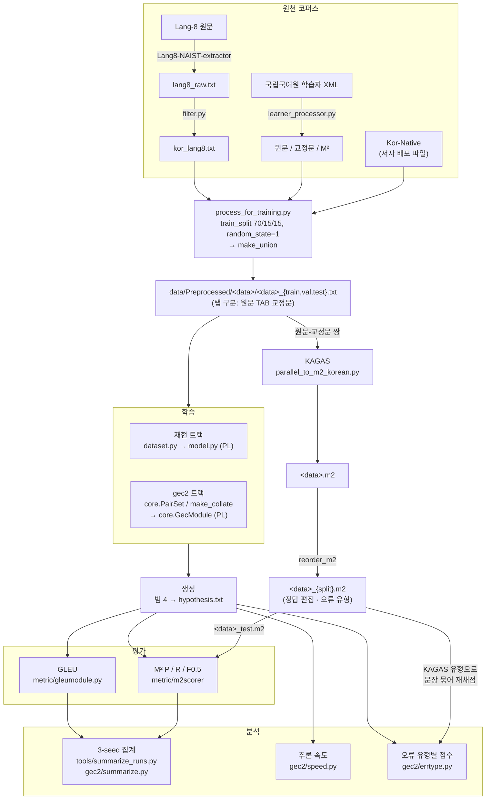
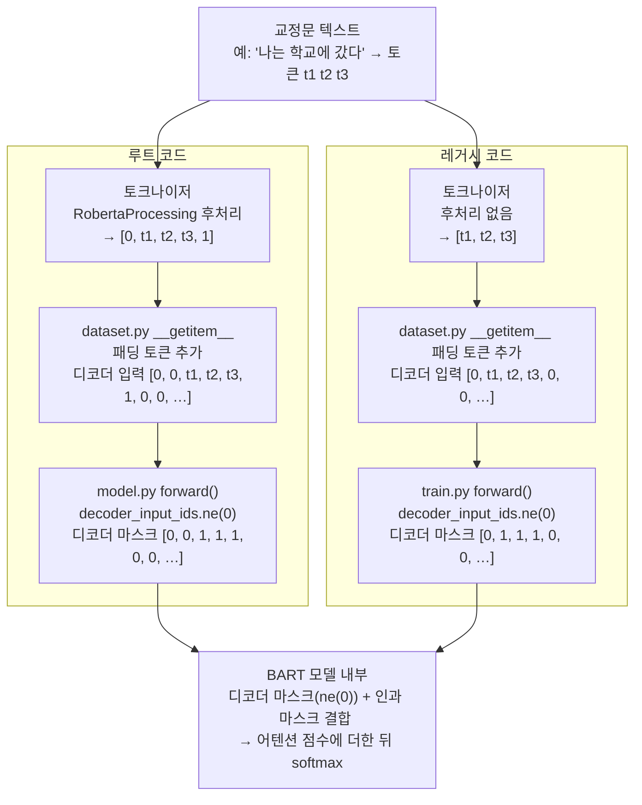

# KoBART 재현 실험 코드 해설

## 1. 데이터 흐름

---

## 2. 단계별 설명

### 2.1. 데이터 전처리

#### 2.1.1. 원본 데이터 명세(Yoon et al. 논문 저자가 작성한 코드)

전체 실험에서 사용한 데이터는 Yoon et al.의 저자를 통해 제공받은 데이터셋을 이용했다. 데이터셋은 native, learner, union으로 구성되어 있어, 논문의 실험을 재현하기 위해 union에 병합되어 있는 lang8 데이터를 별도로 추출했다.

lang8 데이터는 Lang-8.com 이라는 사이트의 데이터셋을 기반으로 Yoon의 저자가 정제한 데이터이다. 한국어 외의 외국어가 섞여있거나, 교정자의 코멘트가 섞여 있거나, 원문과 교정문의 길이 차이, 편집거리 차이가 너무 커서 새로운 문장에 가까운 문장으로 변형된 사례 등 실제로 사용할 수 없는 데이터를 정제하여 최종적으로 109,560쌍의 오류문-교정문 데이터를 묶은 txt 파일로 생성했다. (`get_data/filter.py`) 다만, 저자 제공 데이터셋에서는 별도의 lang8 데이터 파일이 없어 union에서 native, learner를 제외하는 방식으로 추출했다.

learner 데이터는 국립국어원에서 제공하는 외국인 한국어 학습자 말뭉치(kcorpus.korean.go.kr)의 파일을 정제한 데이터 28,426쌍이다. 문어, 구어로 나뉜 원데이터 중에서 문어 데이터만 사용했고, 저자가 직접 데이터를 검토해서 주석이 부실한 문장을 걸렀다. 원데이터는 xml 형식의 파일로 오류문장과, 오류문장에서 수정이 필요한 부분에 대한 주석을 형태소 단위로 주석으로 첨부했다. 저자는 이 데이터를 정제하여 주석 내용을 $\text{M}^2$ 형식으로 변환하고 주석을 반영한 교정문을 txt 파일로 생성했다. (`get_data/korean_learner/` 내의 파일) 단, 이 과정에서 생성한 $\text{M}^2$는 이후 단계에서 별도로 사용하지 않았다.

native 데이터는 한국어 교수 학습 샘터와 국립국어원에서 제공하는 한국어 사전의 예문을 추출하여 교정문으로 삼고, TTS로 읽은 것을 한국어를 모국어로 하는 일반인이 받아쓰기를 한 뒤 틀린 문장을 오류문으로 삼은 전체 17,559쌍의 txt 파일이다. 받아쓰기는 크라우드 소싱을 통해 진행한 것으로 밝히고 있다.

union 데이터는 위 세 종류의 데이터를 학습-검증-테스트 데이터로 70%-15%-15% 분할한 뒤, txt 파일을 이어붙이는 방법으로 생성했다. (`get_data/process_for_training.py`)

---

#### 2.1.2. 원본 데이터 검증(새롭게 작성한 코드)

저자에게 제공받은 데이터가 논문에서 밝히고 있는 명세와 일치하는지 여부와 이후 단계에서 활용하는 데에 문제가 없는지 여부를 `tools/check_data.py`, `tools/check_split_nfkc.py` 파일을 통해 검증했다.

- `tools/check_data.py` 파일 검증 내용

    - 데이터셋의 오류문-교정문 쌍의 수가 논문에서 밝히고 있는 것과 일치하는지 여부

    - [오류문] [TAB] [교정문] 형식으로 배열되었는지 여부

    - 중복된 문장이 없는지 여부

    - 비율에 맞게 분할되었는지 여부

    - m2 파일이 txt 파일과 일치하는지 여부(문장 수, 문장 내용)

    - union의 문장 수와 문장 종류가 native+learner+lang8과 일치하는지 여부

- `tools/check_split_nfkc.py` 파일 검증 내용

    - `random_state=1` 조건에서 70-15-15 분할이 재현되는지 여부

    - 데이터셋이 NFKC로 정규화되어있는지 여부 확인 및 변환(데이터셋 전체가 이미 NFKC로 정규화되었음)

---

### 2.2. 파인튜닝

데이터셋을 이용하여 (1) Yoon(2023) 논문의 KoBART 파인튜닝을 재현하고, (2) KoBART 이외의 BPE 언어모델을 파인튜닝했다.

#### 2.2.1. 논문 실험 재현(재현 트랙)

- 저자 코드는 깃허브의 `soyoung97/Standard_Korean_GEC`에 공개하고 있다. 여기에서는 실행용 코드를 두 종류 제공하고 있다. `/`에 저장한 코드(루트 코드)는 실험 재현을 위해 제공한 코드이고, `src/KoBART-gec/`의 코드(레거시 코드)는 논문 작성을 위해 실행한 코드이다. 

- 이 중, `encode()` 메소드의 작동 방식에서 루트와 레거시의 차이가 크다. 루트는 텍스트 입력을 받았을 때에 토큰화하는 과정에서 문장 시작 토큰 `bos=0`과 문장 종료 토큰 `eos=1`을 자동으로 붙이고, 레거시는 이 토큰을 붙이지 않는다. 이 문제는 후술하는 데이터 누설로 이어졌고, 따라서, 본 실험은 레거시 코드를 기준으로 진행했다. 두 코드의 차이점은 아래와 같다.

| 항목 | 루트 코드 | 레거시 코드 |
| --- | --- | --- |
| 환경 | transformers 4.8.1, PyTorch Lightning 1.1.0, torch 1.7.1 | transformers 4.0.0 |
| 사전학습모델 출처 | HF `hyunwoongko/kobart` | SKT `kobart` pip 패키지 (`get_pytorch_kobart_model`, `get_kobart_tokenizer`) |
| 토크나이징 결과 처리 | 입력값 앞 뒤에 `<s> … </s>` 추가 | 특수 토큰 추가 없이 원본 텍스트의 인덱스값만 출력 |
| 학습률 | linear, warmup 0.0 | cosine, warmup 0.1 |
| gradient clipping | 없음 | 1.0 (`configure_fixed_args`에 고정) |
| lr 기본값 | 5e-5 | 3e-5 |
| repetition_penalty | 학습·평가 코드에는 없음 (README 데모만 2.0) | 없음 |
| 체크포인트 저장 | 10 epoch마다 전부 저장 (`every_n_epochs=10`, `save_top_k=-1`) | 검증 GLEU 최고 1개 (`save_top_k=1`) 후 `trainer.test` |
| 인자값 설정 | `--recipe root` | `--recipe legacy` |

- `tokenizer_setup.py` : 호출하는 모델의 특수 토큰(bos=0, eos=1, pad=3, unk=5, mask=6) 인덱스를 검사하고 모델에서 생성하는 특수 토큰의 일관성을 맞추기 위한 코드 / 실험을 위해 신규 작성

- `dataset.py` : Dataset, LightningDataModule을 상속한 KoBARTGecDataset, GecDataModule을 선언하는 코드 / Yoon(2023)의 코드를 그대로 사용

- `run.py` : 파인튜닝, 검증, 평가 작업을 수행하는 코드
    
    - 실험 환경과 `skt/kobart` 모델을 기준으로 설정값만을 변경하여 루트/레시피 코드의 결과를 재현할 수 있도록 args값과 토크나이저 설정(`tokenizer_setup.py`)을 별도로 설정

- `model.py` : 파인튜닝 전의 언어모델과 파인튜닝, 검증, 평가에 필요한 인자값 및 메소드를 정의
    
    - 루트/레거시 환경의 PyTorch Lightning 1.1.0이 실험 환경에서 PyTorch Lightning 2.x로 바뀌면서 손실함수 처리 방식이 달라졌는데 원본 코드의 작동을 최대한 유지하기 위해서 별도의 손실함수 저장 방식 정의

    - GLEU, $M^2$ 점수 평가 방식을 별도 코드로 분리했기 때문에 `eval_epoch_end()`에서 관련 부분을 삭제 

- (실행 스크립트) `tools/run_one.sh`, `tools/run_all.sh` : `run.py`를 인자값과 묶어서 호출하는 쉘스크립트. `run_all.sh`는 기획한 실험 세팅 환경을 한꺼번에 실행하는 명령

- (실행에서 격리 필요) `tools/check_special_tokens.py` : `skt/kobart`와 `hyunwoongko/kobart`의 토크나이저 구성과 출력 형식이 일치하도록 구현되어 다른 모델을 사용할 때에도 입력 데이터가 동일하게 들어가는지를 체크하기 위한 파일 / 실험을 위해 신규 작성 

- (삭제 필요) `tools/check_tokenizer.py` : 언어모델에서 특수 토큰에 어떤 인덱스를 배정했는지를 출력하는 코드

---

#### 2.2.2. BPE 모델 확장(gec2 트랙 / 신규)

- `gec2/core.py` : 

    - `train_seq2seq.py`, `core.py`, `run_queue.sh`를 거쳐 실행

- `gec2/evaluate.py`

- `gec2/precheck.py`

---

#### 2.2.3. 트랜스포머 환경 차이로 인한 데이터 누설 문제

- 루트/레거시 코드를 그대로 실행하면 인과 어텐션 마스킹 과정에서 오류가 생겨 디코더 파인튜닝 단계에서 교정문의 전체가 드러나고, 이 때문에 논문이 제시하는 것보다 모델의 GLEU, $F_0.5$ 점수가 낮아지는 문제가 있다. 원인은 (1) 패딩 토큰과 문장 시작 토큰의 인덱스 일치, (2) 재현 실험 환경 차이이다. 

(1) 데이터 처리 과정

- 두 코드는 공히 패딩 토큰과 문장 시작 토큰의 번호가 0번으로 동일하다. (일반적으로 언어 모델의 문장 시작 토큰과 패딩 토큰은 다른 인덱스 번호를 가진다. KoBART는 모델의 기본 설정에서 문장 시작 토큰은 0, 패딩 토큰은 3번을 가진다. GEC2 실험에서는 모델이 가지고 있는 토큰 번호를 그대로 활용했다.)

- 레거시 코드의 토크나이저에서는 자연어를 토큰화만 진행하고 `RobertaProcessing` 후처리를 하지 않는다. 따라서, 토큰화를 거쳐도 각 문서의 맨 앞과 맨 뒤에 0, 1이 들어가지 않는다. 이후, 각 문장의 시작을 알리는 문장 시작 토큰 0번을 맨 앞쪽에 추가하고, 길이가 짧은 문서의 뒷쪽에는 패딩 토큰 0을 채운다. 결과적으로 토큰화가 끝난 데이터는 `[0, (자연어 토큰 인덱스 번호)…]` 형태가 된다.

- 루트 코드의 토크나이저에서는 `RobertaProcessing` 후처리 설정이 있어서 전체 텍스트 데이터를 토큰화 한 인덱스값의 맨 앞과 맨 뒤에 각각 문장 시작 토큰 0, 문장 종료 토큰 1을 자동으로 입력한다. 이 때문에 패딩 토큰을 추가하고 나면 각 문서의 맨 앞에 0이 두 번 들어가게 된다. 결과적으로 토큰화가 끝난 데이터는 `[0, 0, (자연어 토큰 인덱스 번호)…]` 형태가 된다.

- 이후, 패딩 토큰 입력을 막기 위해 패딩 토큰의 번호에 해당하는 0번 토큰을 모두 마스킹 처리한다(패딩 마스크). 모델 파인튜닝 중에는 디코더 파인튜닝 단계에서 인과 어텐션 마스크를 적용하여, 각 단계마다 생성하는 토큰의 바로 앞 인덱스까지만 노출이 되도록 매 단계마다 마스킹 처리를 하고 어텐션 계산이 이루어진다(인과 마스크). 따라서, 최종적으로 파인튜닝에 사용하는 마스크는 패딩 마스크와 인과 마스크가 모두 적용된다.

(2) 패딩 마스크 문제

- 루트 코드에서 사용한 `hyunwoongko/kobart` 모델의 토크나이저에서는 특수 토큰을 추가하는 설정이 기본값으로 지정되어 있다. 이 때문에 자연어 데이터가 토크나이저를 통과하면 문장 시작 토큰의 번호가 0으로 지정되어 강제로 문서의 가장 앞 부분에 0번 토큰이 추가된다. 반면, 레거시 코드에서 사용한 `skt/kobart` 모델의 토크나이저에서는 특수 토큰을 추가하는 설정이 기본값으로 지정되어 있지 않다. 이 때문에 레거시 코드를 실행하면 문장 시작 토큰이 추가되지 않고 자연어 토큰만으로 이루어진 데이터로 변환된다.

- 루트/레거시 코드에서 패딩 마스크를 생성하는 방식은 토큰화가 완료된 데이터에서 토큰 번호가 0인 지점의 데이터를 마스킹 처리한다. 그런데 문장 시작 토큰과 패딩 토큰이 공통의 토큰 번호를 사용하기 때문에 패딩 마스크 생성 과정에서 문장 시작을 알리는 0번에도 마스킹이 적용된다. 원래, 교정문 생성을 모델에 학습시키려면 첫 단계에서 0번 인덱스에 해당하는 토큰을 오류문을 보고 생성하도록 해야 한다. 그래서 가장 처음에는 문장 시작 토큰 외 나머지 전체 문장은 볼 수 없는 상태에서 학습을 하고, 1번 인덱스를 생성하기 위해서는 문장 시작 토큰과 0번 인덱스를 보고 생성 학습을 한다. 이 학습 결과를 바탕으로 디코더의 가중치를 조정한다. 그런데 패딩 마스크가 문장 시작 토큰에 적용되면 가장 첫 단계에서 문장 시작 토큰이 보여야 하는데 가려지게 되어 제대로 학습이 이루어지지 않는다.     

- 이것이 루트/레거시 코드의 작동 과정을 재현하는데에 걸림돌이 된 가장 중요한 이유이다.

(3) 트랜스포머 버전에 따른 마스킹값 차이와 이로 인한 학습 데이터 누설

- 트랜스포머 버전에 따라 마스킹이 적용된 데이터를 처리하는 방식에 차이가 있다. 저자의 코드를 통해 강제로 할당된 패딩 마스크값과 디코더 학습 과정에서 모델이 생성한 인과 마스크의 값은 다음과 같이 부여된다.

| 버전 | 패딩 마스크값 | 인과 마스크값 | 최초 디코더 학습 데이터 `bos` 위치의 패딩 마스크값 | 최초 디코더 학습 데이터 `bos` 위치의 인과 마스크값 | 최초 디코더 학습 데이터 `bos` 위치의 최종 마스크값 | 첫 칸 예외 처리 기능 |
| --- | --- | --- | --- | --- |--- | --- |
| `transformers=4.0.0` (레거시 환경) | `-inf` | `-inf` | `-inf` | `-inf` | `-inf` | 있음: `mask[:, 0] = mask[:, 1]` |
| `transformers=4.8.1` (루트 환경) | `finfo.min` | `-inf` | `finfo.min` | `0` | `finfo.min` | 없음 |
| `transformers=4.44.2` (실험 환경) | `finfo.min` | `finfo.min` | `finfo.min` | `finfo.min` | `finfo.min` | 없음 |

- 레거시 환경의 트랜스포머에서는 패딩 마스크값을 부여하기 위해 사용한 `ne(0)` 메소드의 결과가 `True`인 위치에 `-inf` 값을 부여한다. 루트 환경과 실험 환경에서는 `finfo.min` 값을 부여한다. 레거시/루트 환경에서는 디코더 학습 과정에서 사용하는 인과 마스크에서는 마스킹 지점에 `-inf` 값을 부여하고, 실험 환경에서는 마스킹 지점에 `finfo.min` 값이 부여한다. 최종적으로 디코더 학습에 사용하는 마스크는 패딩 마스크와 인과 마스크를 합산하여 생성하는데, 패딩 마스크, 인과 마스크 중 어느 하나라도 `-inf` 값이 있는 경우 합산했을 때에 `-inf`값이 된다. 반면 실험 환경에서는 두 마스크값이 모두 `finfo.min`이므로 합산해도 `finfo.min` 값이 된다.

- 어텐션 메커니즘에서는 마스크에 소프트맥스를 적용하여 최종적인 키값을 생성한다. 레거시 코드에서는 모든 마스크가 `-inf`값을 가지지만 첫 칸 예외 처리 기능이 있기 때문에 모든 데이터에서 마스크값과 무관하게 문서의 가장 앞 부분 데이터는 드러나서 학습에 투입된다. 따라서, 레거시 환경에서 레거시 코드를 작동하면 소프트맥스를 적용했을 때에 원래 코드의 의도대로 문장 시작 토큰만 보이고 나머지 토큰은 0으로 마스킹된 상태에서 디코더 학습을 시작한다.

- 루트 환경에서는 전체 데이터에 패딩 마스크가 적용이 되고, 문장 시작 토큰에만 마스크가 적용이 안 되는 인과 마스크를 합산했을 때, 문장 시작 토큰 지점의 마스크값은 `finfo.min`이 되고 나머지 지점의 마스크값은 `-inf`가 된다. 루트 환경에서는 첫 칸 예외 처리 기능이 작동하지 않는다. 따라서, 디코더 학습에 가장 먼저 투입되는 최종 마스크는 `[finfo.min, -inf, -inf, ...]` 형태가 되고, 이 값에 소프트맥스 함수를 적용하면 정상적으로 보이는 값과는 다르지만 그래도 문장 시작 토큰값이 가장 크게 나타나는 형태는 유지한 상태에서 어텐션 키값이 계산된다.

- 반면, 실험 환경에서는 최종 마스크가 `finfo.min`만으로 채워진 상태가 된다. 이렇게 모든 값이 마스킹된 데이터가 투입되면 디코더 학습 결과가 `NaN`이 발생한다. 어텐션 메커니즘을 기반으로 작동하는 트랜스포머의 특성상 `NaN`이 하나라도 발생하면 이후 학습 단계와 역전파 단계에서 모든 행렬이 `NaN`으로 오염되어 전체 모델이 훼손되어 작동하지 않는다. 그래서 실험 환경의 트랜스포머에서는 모든 값이 마스킹된 데이터는 마스킹을 적용하지 않은 상태로 학습에 투입하여 `NaN` 발생을 원천 차단한다. 따라서 실험 환경에서는 저자의 의도와 무관하게 디코더 학습 단계에서 첫 번째 토큰을 예측하기 위해서 예측해야하는 모든 토큰을 입력으로 받는 **데이터 누설** 문제가 생긴다. 

(4) 코드 수정

- 실험 환경에서 레거시 또는 루트 코드를 그대로 적용하면 학습 단계에서는 교정문 전체를 보고 학습을 수행하기 때문에 학습 과정의 검증 점수는 높게 나오지만 테스트 단계에서는 교정문 정답을 보지 않고 생성을 해야 하므로 검증 점수가 매우 낮게 나온다. 아래 표는 루트/레거시 코드를 그대로 적용했을 때의 결과와 데이터 누설 문제를 해결했을 때의 성능 측정 점수를 비교하고 있다.

| 코드 | 누설 | 검증 GLEU | 테스트 GLEU | P | R | F0.5 |
| --- | --- | --- | --- | --- | --- | --- | --- |
| 루트 코드(seed0) | 있음 |  39.57 | 38.70 | 25.42 | 21.11 | 24.43 |
| 레거시 코드(seed0) | 있음 |  32.50 | 32.12 | 20.57 | 14.01 | 18.81 |
| 레거시 코드에서 누설을 수정(seed0) | 없음 | 꺼짐 | 42.23 | 40.86 | 42.02 | 19.04 | 33.85 |
| 논문 제시 수치 (3-seed 평균) | | | 46.94 | 45.06 | 43.35 | 24.54 | 37.58 |

- 이러한 문제를 해결하기 위해 레거시 환경의 트랜스포머에서 수행하는 첫 칸 예외 처리와 유사한 방식으로 패딩 마스크를 수정했다. 즉, 모든 마스크에서 일괄적으로 가려져있는 첫 번째 마스크값을 두 번째 마스크값으로 복사하여 실질적으로 첫 번째 마스크값이 항상 보이도록 처리했다. 이러한 방식으로 수정하는 것은 레거시 코드에서만 가능하고 루트 코드에서는 불가능하다. 루트 코드에서는 앞서 설명했던 토크나이저 후처리 때문에 앞 두 개의 마스크값이 항상 가려져있기 때문이다. 또한, 루트 코드는 불필요한 문장 시작 토큰과 문장 종료 토큰이 데이터에 포함되기 때문에 정확한 데이터를 이용한 학습이 어려울 것이라고 판단했다. 따라서, 본 실험에서는 레거시 코드를 기준으로 첫 칸 예외 처리와 유사한 방식으로 패딩 마스크를 수정하여 데이터 누설 문제를 해결했다. 

### 2.3. 교정문 생성 시험 및 평가

2.2. 단계에서 파인튜닝한 모델을 이용하여 테스트용 데이터셋의 오류문을 교정하고 교정문을 생성한 결과를 M2, GLEU로 평가하였다.

### 2.3. 교정문 생성

### 2.4. KAGAS 재현

### 2.5. 평가

